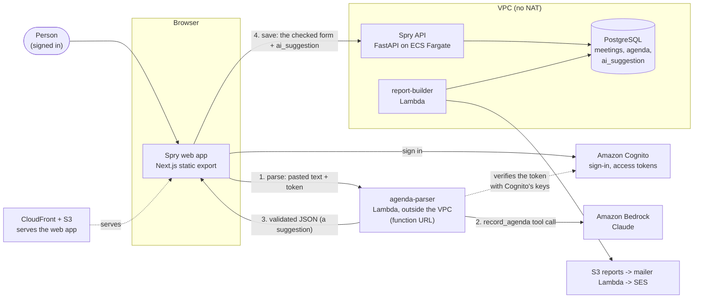

# Container diagram (C4, level 2) - after Lab 6

Updated in Lab 6: the **agenda parser** function and **Amazon Bedrock**, with the two arrows that
matter - *parse* (browser -> parser -> Bedrock) and *save* (browser -> API -> database).

Reading it: the parser never touches the database and never writes anything. The only way data
changes is the *save* arrow, through the API that was already there.
